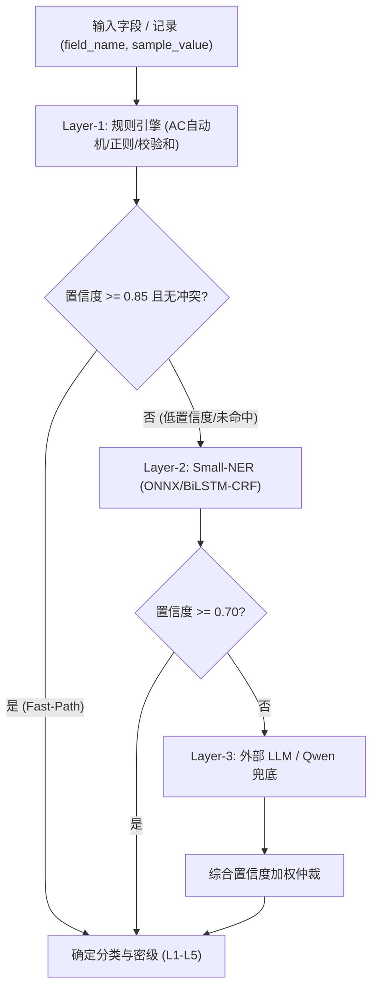

# Python 动态分类分级（Dynclassification）系统设计 (Design)

> **组件归属**：`services/privacy-engine-python`
> **核心源码**：[`engine/dynclassification/`](../../engine/dynclassification/)
> **REST 路由**：[`engine/routers/dynclassification.py`](../../engine/routers/dynclassification.py)

---

## 1. 系统架构与分层设计

数据分类分级是数据安全与隐私保护的基石。PrivShield 动态分类分级子系统采用**三层级联漏斗架构（Three-Layer Cascading Funnel）**，结合高性能规则匹配引擎、轻量级命名实体识别（Small-NER）与大语言模型（LLM）的综合推理能力。

---

## 2. 核心组件职责

### 2.1 规则解析与 Profile 管理 (`ProfileLoader`)
- 解析标准 YAML 文件（`domains/*.yaml`、`taxonomies/*.yaml`、`standards/*.yaml`）。
- 支持基于 `mtime` 的两阶段提交热重载，避免无效规则中断生产。
- 支持 `privshield-policy-bundle/v1` 清单驱动加载与 SHA-256 完整性验真（见 [`bundle.py`](../../engine/dynclassification/bundle.py)）。

### 2.2 14 类内置算子体系 (`operator_registry.py`)
- **模式匹配**：`regex`（正则）、`keyword_contains`（关键词）、`prefix_match`、`suffix_match`、`exact_match`。
- **业务算法校验**：`id_card_checksum`（GB 11643 ISO 7064:1983.MOD 11-2）、`luhn_checksum`（银行卡）、`medical_card_checksum`。
- **网络与编码**：`ip_address`（IPv4/IPv6 CIDR 范围）、`mac_address`、`email`、`icd10_range`（疾病编码）。
- **语言学特征**：`chinese_name`（百家姓与字长校验）、`length_range`。

### 2.3 组合与降级覆盖规则 (`CompositeRuleEngine`)
- 跨字段逻辑组合：例如当 `age < 14` 且存在身份标识时，自动将个人信息提级为**未成年人敏感个人信息 (L4)**。
- 密级降级与强制覆盖（Override）：允许针对脱敏后字段或低风险字段进行受控降级。

### 2.4 外部 LLM 适配与熔断保护 (`llm_adapter.py`)
- 支持 OpenAI 兼容协议、vLLM、Ollama 与 Qwen 本地模型。
- 内置三态熔断器（`Closed` $\to$ `Open` $\to$ `HalfOpen`），当 LLM 响应超时或失败率超标时自动降级至 Layer-1/Layer-2，绝不阻塞数据流水线。
