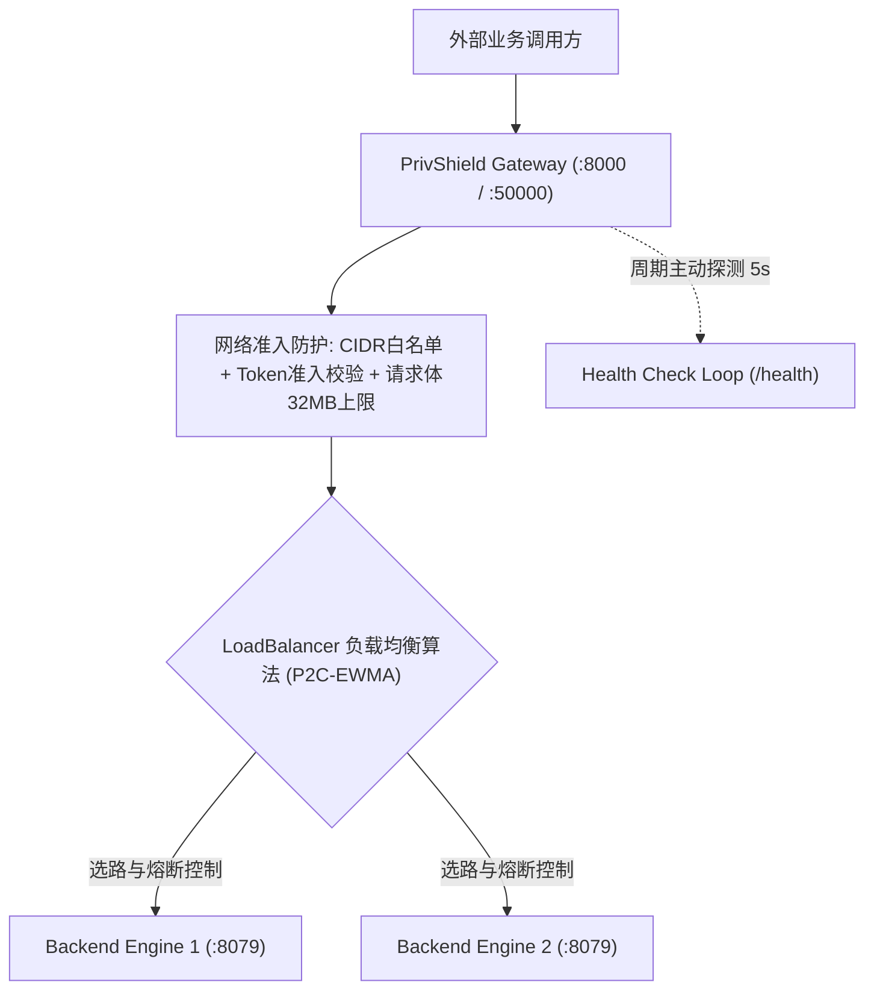

# Python 网关与负载均衡设计文档 (Design)

> **组件归属**：`services/privacy-engine-python`
> **核心源码**：[`engine/gateway/`](../../engine/gateway/)
> **进程入口**：`python -m engine.gateway.server`

---

## 1. 架构总览

PrivShield 网关（Gateway）是引擎服务的前置统一流量入口，提供 REST (`:8000`) 与 gRPC (`:50000`) 的双协议透明反向代理，配合独立运维口 (`:9000`) 提供拓扑监控与健康探活。

---

## 2. 核心调度与稳定性机制

### 2.1 P2C-EWMA 负载均衡 (Power of Two Choices)
- 随机在健康节点集合中选取两个节点 $A$ 与 $B$。
- 计算两者的有效负荷得分：
  $$\text{Score} = (\text{inflight} + 1) \times \max(\text{EWMA\_Latency}, 0.001)$$
- 动态路由至得分较低的节点，避免传统轮询在偶发 GC 或慢查询时的雪崩拥堵。

### 2.2 节点独立三态熔断器 (`CircuitBreaker`)
- **Closed（正常）**：失败计数达到阈值（默认连续 5 次 5xx 错误）后，状态跃迁至 `Open`。
- **Open（熔断）**：节点被剔除出常规选路候选，所有流向该节点的流量被直接阻断，进入冷却期（默认 30s）。
- **Half-Open（半开）**：冷却结束后允许试探性放行 3 个在途请求。若试探全部成功，熔断器复位为 `Closed`；若任一探测失败，立即退回 `Open`。

### 2.3 确定性单次转发原则（Fail-Fast Parity）
网关严格遵循 Go 引擎对齐的**单次转发契约**：对于业务请求绝不自动重试，防止非幂等 POST 操作在后端被重复执行。后端不可用时统一返回标准 502 / UNAVAILABLE，且屏蔽内网地址与敏感堆栈。
