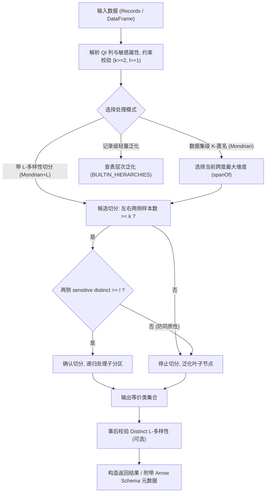

# Python K-匿名与 L-多样性设计文档 (Design)

> **组件归属**：`services/privacy-engine-python`
> **核心源码**：[`engine/privacy/kano.py`](../../engine/privacy/kano.py) · [`engine/privacy/kano_table.py`](../../engine/privacy/kano_table.py) · [`engine/service.py`](../../engine/service.py)
> **REST 路由**：[`engine/routers/kano.py`](../../engine/routers/kano.py)

---

## 1. 概述与设计原则

K-匿名（K-Anonymity）是保护数据发布和共享场景下隐私安全的基础原语。其核心要求是：在经过泛化处理的数据集中，任意一个个体的准标识符（Quasi-Identifier, QI）组合取值，至少与数据集中其他 $k-1$ 个个体的取值不可区分，即形成大小至少为 $k$ 的等价类（Equivalence Class）。

然而，传统的 K-匿名容易遭受**同质性攻击（Homogeneity Attack）**：若某个等价类内所有个体的敏感属性完全相同（例如同一分组内所有病人确诊均为“HIV”），攻击者仅需确定目标在该等价类中即可 100% 推断其敏感隐私。为此，Python 引擎引入 **Distinct L-多样性（L-Diversity）**，强制要求每个等价类内的敏感属性不同取值数必须 $\ge l$。

### 设计原则
1. **纯函数与零副作用**：核心分区与泛化算法为纯函数计算，保证结果严格确定性（Deterministic）且可回归。
2. **两阶段切分护栏**：在 Mondrian 递归划分过程中，只有当二分后两侧的样本数均 $\ge k$，且敏感属性相异基数均 $\ge l$ 时，才允许切分；否则停止切分，保持为更大但满足安全边界的等价类。
3. **多维向量化与高效执行**：支持基于 `pandas` 的向量化加速以及纯 Python 内置算法，提供针对千万级数据流的分块处理能力。
4. **统一双契约兼容**：REST 接口同时兼容 Go 引擎标准契约字段（`records` / `result` / `k` / `group_count`）与 Python 语义字段。

---

## 2. 算法体系与核心流程



---

## 3. 核心算法实现细节

### 3.1 Mondrian 多维分区算法
在 [`engine/privacy/kano_table.py`](../../engine/privacy/kano_table.py) 中，`k_anonymize_table` 递归执行以下步骤：
1. **维度跨度计算**：
   - 数值型列：$\text{span} = \max(values) - \min(values)$
   - 分类型列：$\text{span} = \text{distinct\_count} - 1$
   选择跨度最大的维度作为当前划分轴。
2. **中位数切分点探测**：
   按选定维度升序排序，切分点索引 `split_idx` 必须满足：
   $$\text{split\_idx} \ge k \quad \text{且} \quad (\text{len} - \text{split\_idx}) \ge k$$
   若无法找到满足 $k$ 边界的点，当前节点即为叶子等价类，停止递归。
3. **叶子节点泛化**：
   - 数值型：输出紧凑闭区间 `[min-max]`（若单一值则直接输出原值）；
   - 分类型：输出去重集合 `{val1, val2}`（若单一值输出原值）；
   - 层次命中：若配置了层级树，输出步长层级（如 `[20-30]`、`100***`）。

### 3.2 L-多样性感知切分 (`mondrian_with_l_diversity`)
在分区递归判定中增加回调护栏：
```python
def ldiversity_can_split(left, right, sensitive_field, l):
    return (distinct_field_count(left, sensitive_field) >= l and 
            distinct_field_count(right, sensitive_field) >= l)
```
- **单调性原理**：子集的敏感属性不同取值数不可能超过父集。若某次划分导致任何一侧跌破 $l$，后续无论如何划分都无法恢复合规性。因此直接拒绝该候选划分。

### 3.3 Distinct L-多样性事后检验 (`check_distinct_l_diversity`)
在 [`engine/privacy/kano.py`](../../engine/privacy/kano.py) 中，对已泛化数据集进行完整性审计：
- **确定性键排序**：使用 `sorted(groups.keys())` 对准标识符组合键进行排序，杜绝哈希字典乱序导致的编号漂移。
- **空值排除**：敏感属性中的 `None` 与 `""` 不计入相异基数统计。
- **违规溯源**：返回 `violations` 计数及各个等价类的敏感值频次字典 `sensitive_values`。

---

## 4. 数据结构与 PyArrow 扩展

```python
@dataclass
class GroupDiversity:
    group_index: int
    record_count: int
    distinct_count: int
    sensitive_values: dict[str, int]
    is_compliant: bool

@dataclass
class LDiversityResult:
    is_compliant: bool
    l: int
    min_diversity: int
    violations: int
    group_count: int
    group_stats: list[GroupDiversity]
```

为了方便下游大数据组件（Spark / Ray / DuckDB）的高性能互通，`KAnonymityResult` 与 `KAnonymityRecordResult` 均内置了 `.to_arrow()` 方法，并在 Arrow Table 的 Schema Metadata 中注入专用键：
- `k_anonymity_metadata`：记录 $k$、准标识符列表、生成的真实等价类数量。
- `k_anonymity_record_metadata`：记录记录级泛化应用层级与使用的层级映射。

---

## 5. 性能与复杂度分析

| 操作 | 时间复杂度 | 空间复杂度 | 优化措施 |
|---|---|---|---|
| `k_anonymize_table` | $O(F \cdot N \log N)$ | $O(N)$ | Pandas 向量化快速切分，短路递归 |
| `mondrian_with_l_diversity` | $O(F \cdot N \log N)$ | $O(N)$ | Set 快速求 distinct，提前终止不合规切分 |
| `check_distinct_l_diversity` | $O(N)$ | $O(N)$ | 单遍扫描分组，常量内存哈希聚合 |
| `anonymize_records_batch` | $O(N \cdot F)$ | $O(N)$ | 协作式超时保护（60s 阈值），线性逐行泛化 |
