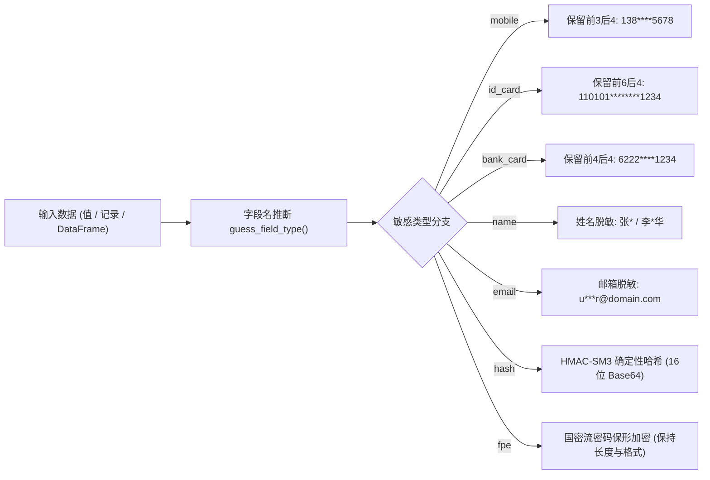

# Python 数据脱敏（Masking）设计文档 (Design)

> **组件归属**：`services/privacy-engine-python`
> **核心源码**：[`engine/privacy/masking.py`](../../engine/privacy/masking.py)
> **REST 路由**：[`engine/routers/masking.py`](../../engine/routers/masking.py)

---

## 1. 架构总览

PrivShield 脱敏模块提供企业级静态与动态脱敏原语，具备**字段名感知（Field-Name Awareness）**与**国密密码学标准支持（SM3/SM4/HMAC-SM3）**。所有底层脱敏函数均为无副作用的纯函数计算。

---

## 2. 核心技术特性

### 2.1 字段名边界推断 (`guess_field_type`)
针对常见短词（如 `tel`, `name`, `card`, `id`），使用正则表达式词边界 `\b` 匹配或下划线切分，有效避免在无关字段（如 `update_name`、`identifier`）中发生误判。

### 2.2 格式保留掩码规则
- **手机号**：验证 11 位数字格式，保留前 3 位运营商号段与后 4 位，中间 4 位替换为 `****`。
- **中国大陆居民身份证**：18 位，保留前 6 位行政区划代码与后 4 位（含校验码），中间 8 位出生年月日替换为 `********`。
- **银行卡号**：保留前 4 位卡 BIN 与后 4 位，其余位打码。
- **中文姓名**：单字名（2 字）掩后字（`张*`）；3 字及以上保留首尾字（`李*华`、`诸**明`）。
- **邮箱**：用户名长度 $\le 2$ 则全掩，长度 $> 2$ 保留首尾字符，域名完整保留。

### 2.3 国密安全哈希与保形加密
- **HMAC-SM3 确定性摘要**：采用 GMSSL 或纯 Python 原生 SM3 算法实现，配合服务端非公开密钥对高敏字段执行保真关联去重，输出统一截断为 16 字符安全 Base64。
- **保形加密 (FPE Numeric)**：针对数字串（如卡号、序列号），利用 HMAC-SM3 构造伪随机密钥流（Keystream），按位进行模 10 映射，确保加密后仍然为同长度数字串，且可解密还原。

### 2.4 Arrow 向量化与批处理加速
利用 `pyarrow.compute` 与 `pandas` 列操作对整表执行列级并行脱敏，避免原生 Python 逐行遍历的性能瓶颈。
