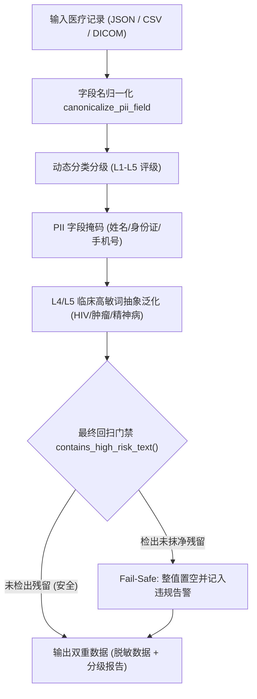

# Python 医疗数据治理流水线设计 (Design)

> **组件归属**：`services/privacy-engine-python`
> **核心源码**：[`engine/medical_pipeline/`](../../engine/medical_pipeline/)
> **REST 路由**：[`engine/routers/medical.py`](../../engine/routers/medical.py)

---

## 1. 架构定位与业务场景

医疗健康数据（医保结算、康养照护、电子病历 EHR）是所有数据治理场景中安全密级最高、法律责任最重的领域。国家及地方标准对传染病（HIV、乙肝）、恶性肿瘤、精神疾病等高敏病种有极其苛刻的防护要求。

PrivShield 医疗治理流水线实现了**单次请求内的分类分级 + PII脱敏 + 极高敏词汇（L4/L5）智能抹平 + 最终泄露兜底门禁**。

---

## 2. 核心技术机制

### 2.1 临床词库与抽象标签泛化
传统脱敏通常直接使用 `***` 遮盖，可能导致医保理赔与流行病学统计完全无法分析病种大类。流水线采用**语义抽象归一化（Abstraction Tagging）**：
- HIV / 获得性免疫缺陷 $\to$ `[IMMUNODEFICIENCY]`
- 恶性肿瘤 / 淋巴癌 $\to$ `[MALIGNANT_NEOPLASM]`
- 精神分裂症 / 双相情感障碍 $\to$ `[PSYCHIATRIC_DISORDER]`
既消除了具体微观病灶泄露，又保留了宏观统计的有效性。

### 2.2 双保险最终泄露门禁 (`Fail-Safe Output Gate`)
即便前序规则或 NER 引擎因拼写变体或长句出现漏标，流水线在最终组装输出前，会对整条已脱敏记录执行无差别字符串回扫 (`contains_high_risk_text`)。一旦检测到仍有高敏敏感词逃逸，**立即触发整字段置空销毁**，确保 `guarantee_no_l4_l5_raw_data = True`。
