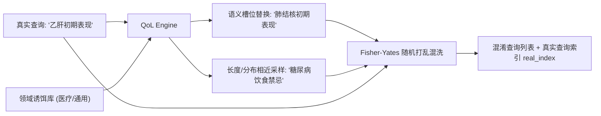

# Python 查询混淆（QoL / Query Obfuscation）设计文档 (Design)

> **组件归属**：`services/privacy-engine-python`
> **核心源码**：[`engine/privacy/qol.py`](../../engine/privacy/qol.py)
> **REST 路由**：[`engine/routers/qol.py`](../../engine/routers/qol.py)

---

## 1. 业务场景与原理

在医疗健康咨询、个人征信查询等交互式搜索应用中，用户每次向云端搜索服务发送的查询请求（Query）都暴露了其当下的高度隐私意图（如“乙肝初期症状”、“小额网贷逾期”）。即便信道采用 TLS 加密，服务商自身仍能收集查询日志。

**查询混淆（Query Obfuscation Level, QoL）**通过在真实查询中混入 $k$ 条语义相近、语法合规的诱饵假查询（Dummy Queries / Decoys），并经 Fisher-Yates 随机置乱后一并发往上游。服务端无法在统计上区分哪个是真实意图，使重识别先验概率下降至 $\frac{1}{k+1}$。

---

## 2. 核心混淆策略

1. **语义槽位替换 (`slot_filling`)**：
   识别查询中的核心实体（如疾病名称、症状名词），从受信任的同类实体词典中抽样替换，保持句式语法结构与搜索上下文的高度拟真性。
2. **长度与分布相似抽样 (`length_similarity`)**：
   若无匹配槽位，从诱饵语料库中选择长度与词频分布接近的查询无放回抽样。
3. **混合策略 (`hybrid`)**：
   结合语义槽位与语料抽样，确保生成的 $k$ 个诱饵既有高度相关性又有足够多样性。
4. **密码学安全随机置乱**：
   采用 `secrets.SystemRandom` 执行 Fisher-Yates 均匀置乱，杜绝根据索引位置进行差分去噪。
